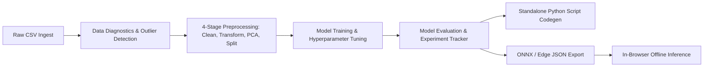

# Interactive ML Model Studio & Visual Codegen Platform

An enterprise-grade, visual end-to-end Machine Learning Studio and standalone Python Codegen platform. Designed to eliminate data leakage, automate quality diagnostics, enable orthogonal dimension reduction via PCA, and export production-ready pipelines to ONNX and offline edge environments.

---

## 👥 Team & Responsibilities

| Team Member | GitHub Username | Role | Primary Contributions |
| :--- | :--- | :--- | :--- |
| **Sagarika Wankhede** | `SagarikaWankhede` | **Person A (Data & Backend Core)** | Dataset ingestion, SHA-256 integrity, data integration (merge/concat), automated diagnostics (leakage, imbalance, outliers, noise), SQLite schema & seed demo datasets. |
| **Hiral Gupta** | `Hiral25-og` | **Person B (ML Engine & Edge)** | Zero-leakage `RecipeRunner`, PCA dimension reduction, power transforms, model training/evaluation, ONNX graph export & sub-millisecond Edge JSON deployment. |
| **Laxmi Singla** | `Laxmi_singla` | **Person C (Frontend & Codegen)** | React application, 4-stage preprocessing UI, interactive 6-node Pipeline DAG canvas, experiment comparison dashboard, offline Edge simulator & standalone Python codegen. |

---

## 🚀 Key Features

1. **Automated Data Quality & Diagnostics Engine (Person A)**:
   - Rule-based detection of missing values, high cardinality, class imbalance, and potential target leakage.
   - IQR and Z-Score outlier detection with automated clipping suggestions.
   - Dataset integration capabilities supporting both horizontal column merges and vertical row concatenations.

2. **Zero-Leakage ML Execution Core (Person B)**:
   - Strict train/val/test split isolation prior to fitting any scalers, encoders, or dimension reduction transformers.
   - PCA (Principal Component Analysis) orthogonal decomposition with configurable component counts.
   - Deterministic caching with SHA-256 recipe fingerprinting.

3. **Visual Pipeline DAG & Interactive Codegen (Person C)**:
   - Live 6-node reactive DAG showing complete data lineage from Raw Ingest to Edge Export.
   - Dual-tab code generator producing 100% standalone scikit-learn Python scripts with zero studio runtime dependencies.
   - In-browser offline Edge inference simulator (< 1ms scoring latency).

---

## 🏗️ Architecture Overview



---

## 🛠️ Tech Stack

- **Backend**: Python 3.10+, FastAPI, SQLite, Pydantic, SQLAlchemy.
- **ML Engine**: scikit-learn, NumPy, pandas, ONNX, skl2onnx, SciPy.
- **Frontend**: React 18, Vite, React Router, Lucide Icons, Custom Design System CSS.
- **Export Targets**: ONNX Runtime, Standalone Python `.py`, In-Browser Edge JSON.

---

## 🏁 Quickstart Guide

### 1. Clone the Repository
```bash
git clone https://github.com/BuildsByLaxmi/Interactive-Model-Studio.git
cd Interactive-Model-Studio
```

### 2. Backend Setup
```bash
cd backend
python -m venv venv
# Windows:
.\venv\Scripts\activate
# Linux/macOS:
source venv/bin/activate

pip install -r ../ml_engine/requirements.txt
pip install fastapi uvicorn pydantic python-multipart sqlalchemy

# Seed sample datasets:
python scripts/seed_demo.py

# Run FastAPI backend:
uvicorn main:app --reload --port 8000
```

### 3. Frontend Setup
```bash
cd ../frontend
npm install
npm run dev
```
Open your browser at `http://localhost:5173`.

---

## 📁 Repository Structure

```
Interactive-Model-Studio/
├── backend/                  # FastAPI REST Service & Storage Core (Person A)
│   ├── routers/              # Datasets, Experiments, Models, and Export endpoints
│   ├── services/             # Ingestion, Diagnostics & Integration service
│   ├── scripts/              # Seed demo data generator
│   └── main.py               # Application entry point
├── ml_engine/                # ML Core & Pipeline Runner (Person B)
│   ├── preprocessing.py      # Imputation, Scaling, Power transforms, PCA & Splitting
│   ├── recipe_runner.py      # Zero-leakage chained pipeline execution
│   ├── training.py           # Model training & CV tuning
│   ├── evaluation.py         # Metrics, ROC-AUC, Confusion Matrix
│   └── export_onnx.py        # ONNX and Edge JSON model serialization
├── frontend/                 # Interactive React Application (Person C)
│   ├── src/pages/            # Preprocessing, Pipeline, Dashboard, EdgeExport, DatasetView
│   ├── src/components/       # PipelineCanvas, DiagnosticsDetail, CodePreview, Navbar
│   ├── src/services/         # Standalone Python & ONNX codegen engine
│   └── src/App.css           # Custom design system styling
└── docs/                     # Technical Architecture & Phase Documentation
    ├── architecture.md       # Person A: Backend & Data Architecture
    ├── schema.md             # Person A: Database Schema & Entity Relationships
    ├── ml_engine.md          # Person B: ML Engine & Edge Deployment
    └── frontend_ux.md        # Person C: UI/UX & Codegen Specification
```
