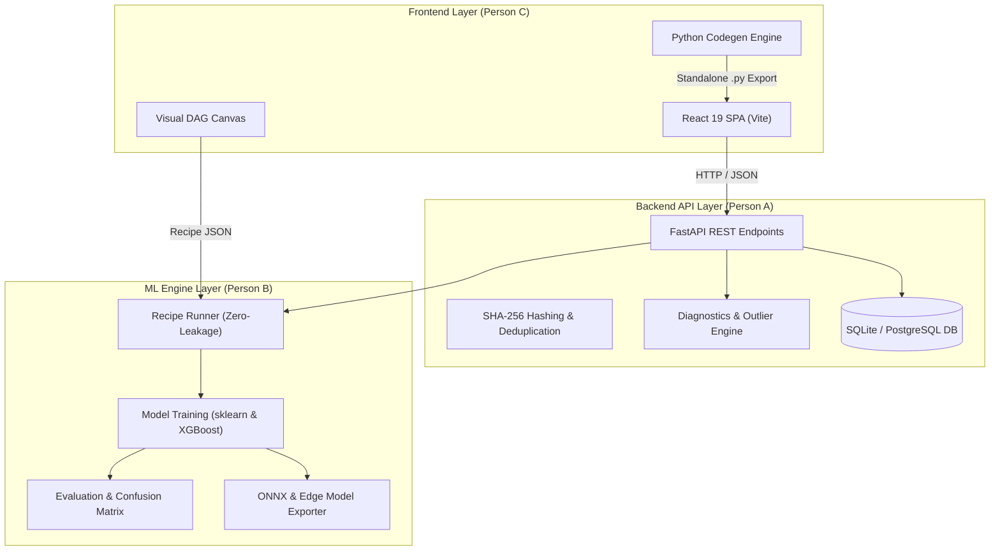

# System Architecture Specification (Person A)

## 1. System Overview
The **Interactive ML Model Studio** is an end-to-end, reproducible machine learning web platform. The platform is architected around a decoupled design:
- **FastAPI Core (`/backend`)**: Handles dataset ingestion, cryptographic hashing, schema inference, data diagnostics, and experiment persistence.
- **ML Engine (`/ml_engine`)**: A modular Python execution engine providing zero-leakage preprocessing, model training, evaluation, caching, and edge export.
- **React Frontend (`/frontend`)**: A low-code visual interface built with React 19, Vite, Recharts, and standalone Python Codegen.

---

## 2. Ingestion & Storage Layer
1. **File Hashing (`hashing.py`)**:
   - Every uploaded CSV/Parquet file is hashed via SHA-256 upon ingestion.
   - Prevents redundant storage allocations and detects dataset versioning.
2. **Schema Inference (`dataset_service.py`)**:
   - Ingested DataFrames are analyzed column-by-column:
     - Numerical vs. Categorical vs. Datetime inference
     - Null percentage and cardinality calculation
     - Summary statistics (min, max, mean, standard deviation)
3. **Data Quality & Diagnostics Engine (`data_processing_service.py`)**:
   - Class Imbalance Check: Evaluates target variable distribution and flags minority classes representing $<15\%$ of samples.
   - High Cardinality Categoricals: Detects string features with $>50$ unique categories prone to one-hot explosion.
   - Data Leakage: Flags features with near-identical distribution to the target variable.
   - Outlier Detection: Computes Tukey's 1.5× IQR fences and Z-score deviations ($|Z| > 3.0$).

---

## 3. REST API Design
The backend exposes clean RESTful endpoints adhering to OpenAPI specifications:

| Method | Endpoint | Description |
|---|---|---|
| `POST` | `/api/datasets/upload` | Uploads raw CSV/Parquet and returns schema metadata. |
| `GET` | `/api/datasets` | Lists all stored datasets with row/column counts. |
| `GET` | `/api/datasets/{id}/preview` | Returns sample head rows for frontend tables. |
| `GET` | `/api/datasets/{id}/diagnostics/outliers` | Deep scan for outliers, variance, and noise. |
| `POST` | `/api/datasets/merge` | Performs relational joins between two datasets. |
| `POST` | `/api/datasets/{id}/clean` | Executes cleaning, imputation, and outlier clipping. |
| `POST` | `/api/runs/execute` | Triggers ML pipeline training and persists metrics. |
| `GET` | `/api/runs` | Retrieves historical experiment runs for comparison. |
| `GET` | `/api/runs/{id}/export/onnx` | Generates and downloads ONNX edge model artifact. |
