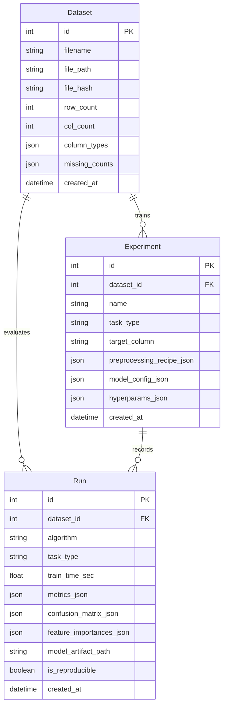

# Database & Entity Schema Specification (Person A)

## Overview
This document specifies the persistent data models for the Interactive ML Model Studio, tracking datasets, preprocessing recipes, experiment configurations, and performance evaluation metrics.

---

## 1. Entity-Relationship Model

---

## 2. Table Definitions

### Table: `datasets`
Stores uploaded tabular datasets and computed summary statistics.

| Field | Type | Description |
|---|---|---|
| `id` | `INTEGER PRIMARY KEY AUTOINCREMENT` | Unique dataset identifier. |
| `filename` | `VARCHAR(255) NOT NULL` | Original uploaded file name (e.g. `customer_churn.csv`). |
| `file_path` | `VARCHAR(512) NOT NULL` | Absolute file system path in `/storage/datasets/`. |
| `file_hash` | `VARCHAR(64)` | SHA-256 hash used to detect duplicate uploads. |
| `row_count` | `INTEGER NOT NULL` | Total number of data rows. |
| `col_count` | `INTEGER NOT NULL` | Total number of columns. |
| `column_types` | `JSON NOT NULL` | Mapping of column name to data type (`numerical`, `categorical`, `datetime`). |
| `missing_counts`| `JSON NOT NULL` | Mapping of column name to number of null values. |
| `created_at` | `TIMESTAMP DEFAULT CURRENT_TIMESTAMP`| Timestamp of dataset ingestion. |

---

### Table: `experiments`
Stores pipeline configurations, preprocessing recipes, and estimator setups.

| Field | Type | Description |
|---|---|---|
| `id` | `INTEGER PRIMARY KEY AUTOINCREMENT` | Unique experiment identifier. |
| `dataset_id` | `INTEGER REFERENCES datasets(id)` | Foreign key referencing source dataset. |
| `name` | `VARCHAR(255)` | User-defined or auto-generated experiment run name. |
| `task_type` | `VARCHAR(50) NOT NULL` | `classification` or `regression`. |
| `target_column` | `VARCHAR(100) NOT NULL` | The target prediction label $y$. |
| `preprocessing_recipe_json` | `JSON NOT NULL` | Ordered list of preprocessing transformations. |
| `model_config_json` | `JSON NOT NULL` | Algorithm name and hyperparameter configurations. |
| `created_at` | `TIMESTAMP DEFAULT CURRENT_TIMESTAMP`| Timestamp of experiment creation. |

---

### Table: `runs`
Stores execution results, benchmarked metrics, and artifact references.

| Field | Type | Description |
|---|---|---|
| `id` | `INTEGER PRIMARY KEY AUTOINCREMENT` | Unique run identifier. |
| `dataset_id` | `INTEGER REFERENCES datasets(id)` | Foreign key referencing source dataset. |
| `algorithm` | `VARCHAR(100) NOT NULL` | Estimator algorithm name (e.g. `RandomForestClassifier`). |
| `task_type` | `VARCHAR(50) NOT NULL` | `classification` or `regression`. |
| `train_time_sec` | `FLOAT NOT NULL` | Training duration in seconds. |
| `metrics_json` | `JSON NOT NULL` | Accuracy, F1, Precision, Recall, ROC-AUC, RMSE. |
| `confusion_matrix_json`| `JSON` | True/False Positive/Negative counts & class labels. |
| `feature_importances_json`| `JSON` | Ranked feature importance coefficients. |
| `model_artifact_path` | `VARCHAR(512)` | Path to saved `.joblib` model artifact. |
| `is_reproducible` | `BOOLEAN DEFAULT TRUE` | Verified deterministic output match. |
| `created_at` | `TIMESTAMP DEFAULT CURRENT_TIMESTAMP`| Timestamp of run completion. |
